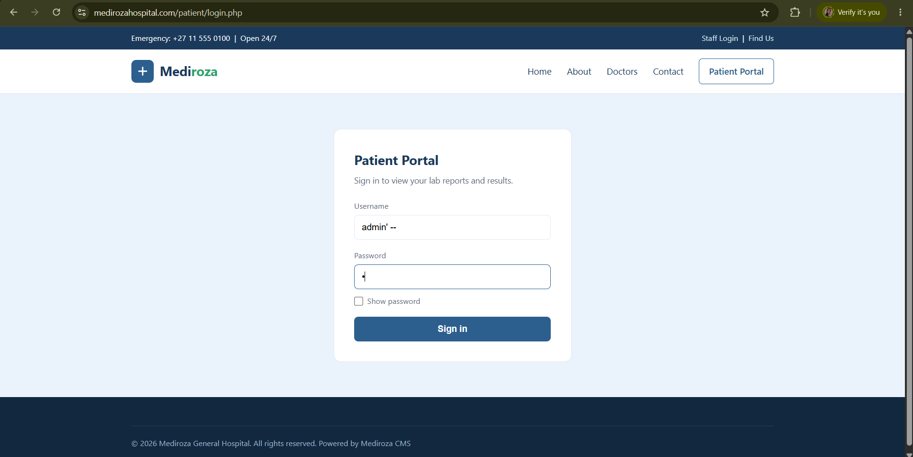
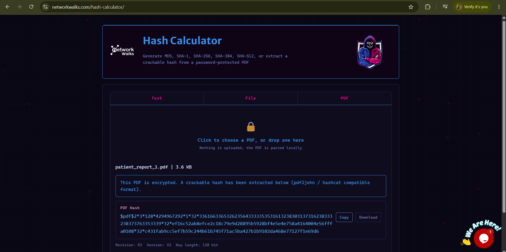
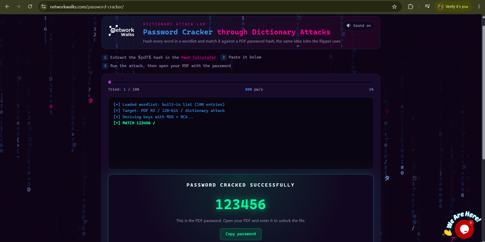
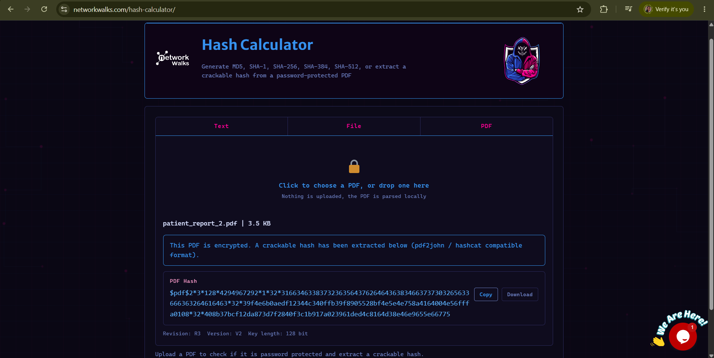
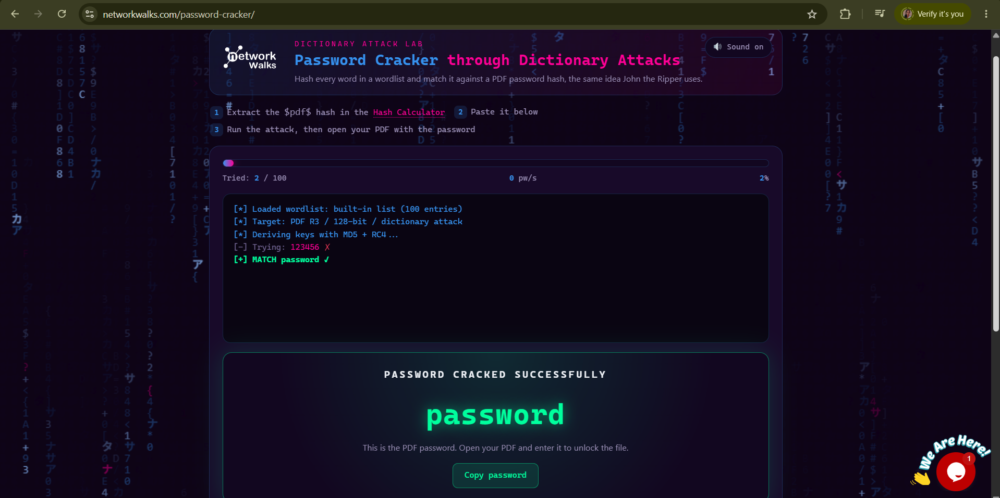
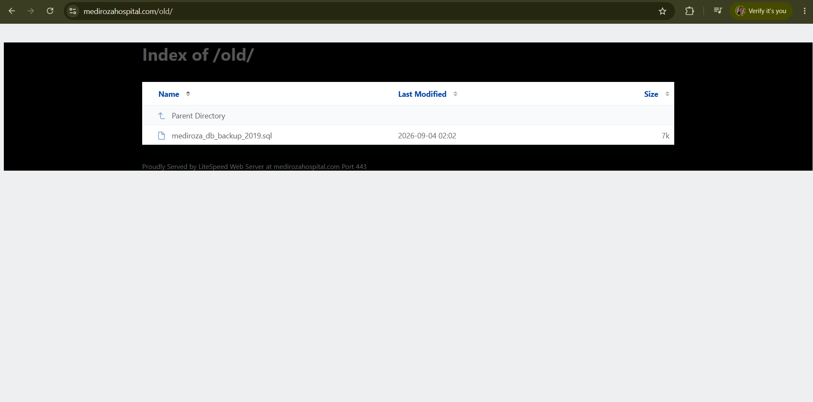
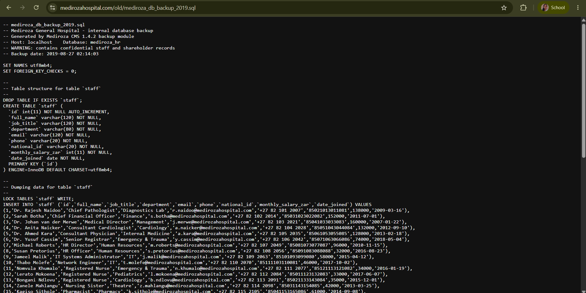
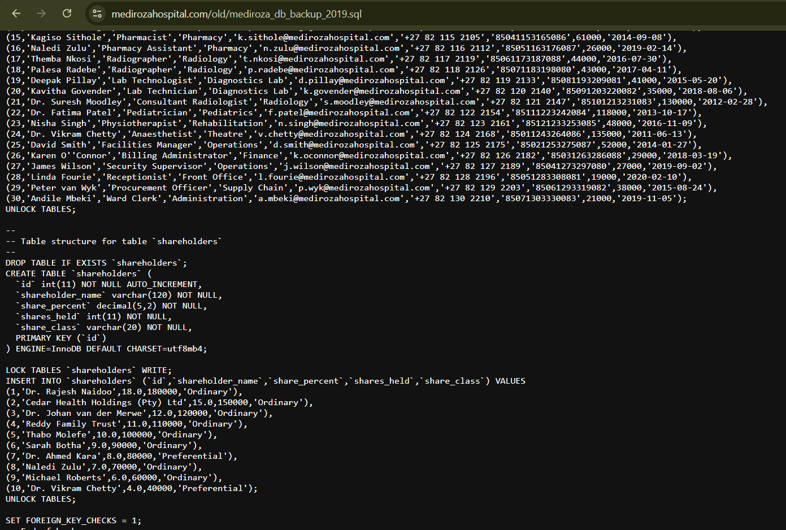

# 🔐 Mediroza General Hospital — Black-Box Penetration Test

**Week 4 Capstone Project — NetworkWalks Cybersecurity & Ethical Hacking Internship**

  
  
  
  
  
  

---

<table>
<colgroup>
<col style="width: 34%" />
<col style="width: 65%" />
</colgroup>
<thead>
<tr class="header">
<th><strong>Pentester Name (Cybersecurity Student)</strong></th>
<th><strong>Sneha Hariprasad Pillai</strong></th>
</tr>
<tr class="odd">
<th><strong>Program/Batch</strong></th>
<th>B084 — NetworkWalks</th>
</tr>
<tr class="header">
<th><strong>Date</strong></th>
<th>24 November 2026</th>
</tr>
<tr class="odd">
<th><strong>Modules completed</strong></th>
<th>
M1 — Initial Access

M2 — Attack (Cracking)

M3 — Data Extraction
</th>
</tr>
<tr class="header">
<th><strong>Client/Target</strong></th>
<th>Mediroza General Hospital — https://medirozahospital.com (simulated training target assigned by NetworkWalks)</th>
</tr>
<tr class="odd">
<th><strong>Permission secured from client?</strong></th>
<th>Yes — written authorisation granted by NetworkWalks for this engagement</th>
</tr>
<tr class="header">
<th><strong>Engagement type</strong></th>
<th>Full black-box penetration test</th>
</tr>
</thead>
<tbody></tbody>
</table>

## 1. Liability Disclaimer

I performed these activities only against the target explicitly assigned and authorised by NetworkWalks for this capstone project. All materials in this repository are for education and assessment purposes only. Do not use anything here to break the law. The instructor, the authors and NetworkWalks are not responsible for what you do with this knowledge. Every action you take is your own responsibility. Misuse of these techniques against systems you do not own or have no permission to test is a crime in most countries, even when nothing is damaged.

## 2. Introduction

This report covers my Week 4 capstone black-box penetration test against the simulated training target `medirozahospital.com`, assigned as part of my ongoing NetworkWalks internship. The engagement followed the three technical milestones set out in the project brief: gaining initial access to the site and retrieving three confidential patient PDF lab reports (M1), cracking the encryption on all three retrieved files (M2), and locating a further critical data exposure on the server — staff salaries and shareholder details (M3).

I worked through this independently, starting with passive and active reconnaissance, then testing the authentication mechanisms I found, and finally following up on a disclosed backup file to complete the data-extraction milestone. Every step below includes the exact command or tool used, the result I observed, a screenshot as evidence, and a short note on why the finding matters from an attacker's point of view.

## 3. Tools Used

| **Tool** | **Purpose** |
|---|---|
| Kali Linux (VirtualBox) | Operating system used for all active testing |
| whois | Domain registration lookup |
| dnsrecon | DNS record enumeration (NS, MX, SPF, TXT) |
| nslookup | Resolve the domain to its IP address |
| curl -I / -D | Inspect HTTP response headers and raw server responses |
| wafw00f | Detect a Web Application Firewall |
| whatweb | Fingerprint web technologies / CMS |
| nikto | Web server vulnerability scanner |
| gobuster | Directory / file brute-forcing |
| nmap | Port and service scanning |
| Browser DevTools + manual SQL injection | Test and exploit the login authentication logic |
| NetworkWalks Hash Calculator | Extract a crackable `$pdf$...` hash from a locked PDF |
| NetworkWalks Password Cracker | Dictionary attack against a `$pdf$...` hash |
| wget / cat | Retrieve and read the exposed `.sql` backup file |

## 4. Activities Performed

### 4.1 M1 — Initial Access

**Reconnaissance.** I started with passive and active recon against `medirozahospital.com` using whois, dnsrecon, nslookup, wafw00f, whatweb, curl and nmap. whois showed the domain registered through NameCheap/GoDaddy infrastructure with hosting on `namecheaphosting.com` name servers. dnsrecon enumerated the SOA/NS/MX/TXT/SPF records (SPF policy `p=none` — no enforcement). wafw00f and whatweb identified a LiteSpeed-fronted server. nmap against the hosting IP showed Pure-FTPd, Exim, BIND, HAProxy and Dovecot services exposed.

**Vulnerability discovery.** nikto flagged directory indexing (CWE-548) on three paths — `/staff/`, `/patient/` and `/old/` — all of which were also listed as `Disallow` entries in `robots.txt`, meaning the site itself pointed me straight at them while trying to hide them from search engines. nikto also flagged missing security headers (`X-Content-Type-Options`, `Strict-Transport-Security`, `Referrer-Policy`, `Permissions-Policy`) and server/CMS version disclosure (`Mediroza CMS 1.4.2` visible in page source). gobuster independently confirmed the same set of accessible paths.

**Authentication bypass.** I inspected both the Staff Login (`/staff/login.php`) and Patient Portal (`/patient/login.php`) forms. Both POST to `login.php` with `username`/`password` fields and no visible client-side protection. I tested a classic SQL injection authentication bypass by submitting `admin' --` as the username with an arbitrary password. This returned the authenticated Patient Portal page instead of a login error — confirmed both in the browser and independently via raw `curl` requests, which returned HTTP 200 with the portal's HTML instead of the login form. A bare `'` character in the username field also triggered a raw MySQL syntax error (`mysqli_query(): You have an error in your SQL syntax...`), confirming the input was being concatenated directly into a SQL query with no sanitisation or prepared statements.

**Retrieving the PDFs.** Once inside the Patient Portal, the "My Lab Reports" page listed three downloadable PDF lab reports. I downloaded all three:
- `patient_report_1.pdf`
- `patient_report_2.pdf`
- `Pathology Report - E. Thompson.pdf` (`patient_report_3.pdf`)

All three were password-protected PDFs, which fed directly into M2. The original locked files are included at `Evidence/M1_Initial_Access/Retrieved_PDFs/`.

### 4.2 M2 — Attack (Cracking)

I extracted a crackable hash from each PDF using the **NetworkWalks Hash Calculator** (which parses the PDF locally in-browser and returns a `$pdf$...` hash in pdf2john/hashcat-compatible format), then ran each hash through the **NetworkWalks Password Cracker**'s dictionary attack against its built-in wordlist.

| PDF | Patient | Hash extracted | Password recovered |
|---|---|---|---|
| `patient_report_1.pdf` | Dlamini | ✅ via Hash Calculator | **`123456`** |
| `patient_report_2.pdf` | Reddy | ✅ via Hash Calculator | **`password`** |
| `patient_report_3.pdf` | E. Thompson | ✅ via `pdf2john` (Kali) | **`!@#$%^&`** |

All three PDFs opened successfully with their recovered passwords, confirming the attack and exposing the underlying lab report content for each patient. The unlocked files are included at `Evidence/M2_Cracking/Decrypted_PDFs/` as proof of successful recovery.

### 4.3 M3 — Data Extraction

Following up on the `/old/` directory that nikto, gobuster and `robots.txt` had all pointed to, I browsed to `medirozahospital.com/old/` directly and found directory indexing enabled, exposing a single file: `mediroza_db_backup_2019.sql` (≈7 KB, last modified 2026-09-04). I retrieved the file directly (`wget`) and reviewed its contents.

The backup contained two tables:
- **`staff`** — 30 records with full name, job title, department, email, phone, national ID and **`monthly_salary_zar`** for every hospital employee, from the Medical Director down to ward clerks.
- **`shareholders`** — 10 records with shareholder name, share percentage, shares held and share class, including entries for several staff members who are also shareholders (e.g. Dr. Rajesh Naidoo, Dr. Johan van der Merwe) plus external holders such as Cedar Health Holdings (Pty) Ltd and the Reddy Family Trust.

This single publicly-downloadable backup file directly satisfies both data points the brief asked for: hospital employee salaries and shareholder details.

## 5. Risk Analysis / Impact

| **#** | **Risk / Finding** | **Evidence / Observation** | **Potential Impact** | **Risk Level** |
|---|---|---|---|---|
| 1 | SQL injection authentication bypass | `admin' --` bypasses login on both Staff and Patient portals; raw MySQL error confirms unsanitised input | Full unauthorised access to patient accounts and potentially staff accounts | **● Critical** |
| 2 | Sensitive database backup publicly downloadable | `.sql` backup in `/old/` exposes full `staff` and `shareholders` tables | Exposure of salaries, national IDs, contact details and shareholder/ownership data for the entire organisation | **● Critical** |
| 3 | Directory indexing enabled | nikto/gobuster confirm indexing on `/staff/`, `/patient/`, `/old/` | Allows direct browsing to sensitive files without needing to guess filenames | **● Critical** |
| 4 | robots.txt discloses sensitive paths | `Disallow: /patient/ /staff/ /old/` lists exactly the sensitive directories | Points attackers straight at restricted areas instead of hiding them | **● High** |
| 5 | Confidential patient PDFs retrievable and weakly encrypted | All 3 PDFs cracked using short, common dictionary passwords | Breach of patient confidentiality; PDF encryption gave no meaningful protection | **● High** |
| 6 | Missing security headers | nikto: no HSTS, X-Content-Type-Options, Referrer-Policy, Permissions-Policy | Increases exposure to clickjacking, MIME-sniffing and downgrade attacks | **● Medium** |
| 7 | Server / CMS version disclosure | `Mediroza CMS 1.4.2` visible in page source; LiteSpeed banner | Helps an attacker target known vulnerabilities for that exact version | **● Low** |

**Risk level key:** ● Critical ● High ● Medium ● Low

## 6. Recommendations

1. **Fix the SQL injection immediately.** Rewrite all database queries to use parameterised/prepared statements instead of string-concatenated input. This is the root cause of the authentication bypass.
2. **Remove or restrict `/old/`.** Delete the legacy backup file from the public web root entirely; backups should never be stored inside a publicly reachable directory.
3. **Disable directory indexing** (`Options -Indexes` or equivalent) on all directories, and apply authentication to `/staff/` and `/patient/` at the server level, not just the application login.
4. **Stop listing sensitive paths in `robots.txt`.** Disallow entries are a hint for crawlers, not an access control — remove them and rely on proper server-side restriction instead.
5. **Enforce strong PDF/document passwords** generated by policy, not short dictionary words, for any confidential file distributed to patients.
6. **Add missing security headers** (HSTS, X-Content-Type-Options, Referrer-Policy, Permissions-Policy) at the web server or application level.
7. **Suppress verbose database errors** in production; return generic error pages instead of raw MySQL syntax errors.
8. **Hide server/CMS version banners** and keep the CMS patched to the latest version.

## 7. Conclusion

Across this capstone engagement I completed all three technical milestones. M1 showed that the Mediroza site's authentication could be bypassed with a classic SQL injection payload, giving unauthorised access to the Patient Portal and three confidential lab report PDFs. M2 showed that all three PDFs were protected with weak, dictionary-crackable passwords, so the encryption gave no real protection once the files were obtained. M3 showed that a sensitive database backup had been left in a publicly indexed directory, exposing the salary and shareholder data of the entire organisation — arguably the most serious finding of the engagement, since it required no exploitation at all, only browsing to a disclosed path.

Taken together, these findings show a consistent pattern: the application trusts user input without validation, and the server exposes internal files and paths that should never have been reachable from the public internet. The recommendations above, if implemented, would close all three issues at their root cause rather than only the symptom.

## 8. Evidences Collected

Screenshots are organised in [`Evidence/`](Evidence/) by milestone.

### M1 — Initial Access (Recon)

### M1 — Authentication Bypass

### M2 — Cracking

### M3 — Sensitive Data Exposure

---

## 💡 What I Learned

- How a login form that concatenates user input directly into a SQL query can be bypassed entirely with a comment-based payload like `admin' --`, without needing to know any real credentials.
- Why `robots.txt` is only a crawler hint, not an access control — and why disallowing a path there can actually tell an attacker exactly where to look.
- How a password-protected PDF's password is stored as a hash (`$pdf$...` format) and recovered through a dictionary attack, and how quickly short, common passwords fall to a 100-word built-in wordlist.
- Why leaving a database backup inside a public web directory is one of the simplest and most damaging mistakes a server can have — it required no exploitation at all, just browsing to a disclosed path.
- The importance of chaining findings together: the robots.txt disclosure, nikto's directory-indexing flag and gobuster's brute-force all pointed at the same `/old/` directory from three different angles.

---

## 🔐 Security & Ethical Use

I performed this engagement strictly against the target assigned and authorised by NetworkWalks for this capstone project, for educational purposes only. These techniques must never be used against any system without explicit written permission from its owner.

---

## 👤 Author

**Sneha Hariprasad Pillai** — B084
Cybersecurity Student, NetworkWalks

LinkedIn: [https://www.linkedin.com/in/sneha-pillai-16994342a/](https://www.linkedin.com/in/sneha-pillai-16994342a/)

---

## 📌 Project Information

**Program Name:** Cybersecurity at NetworkWalks | **Week:** 04 | **Project:** Mediroza General Hospital — Black-Box Penetration Test | **Repository:** GitHub
</content>
</invoke>
